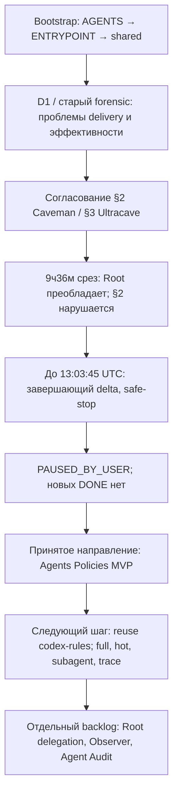
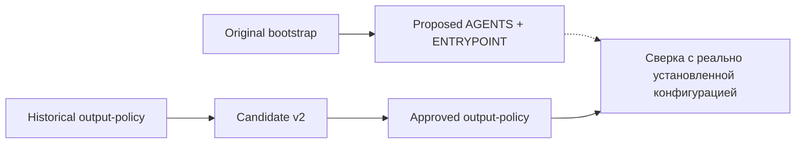

# Схема эволюции workflow и политик

**Это карта решений и результатов аудита, а не история каждой операции.**

## Цепочка версий файлов, не execution evidence

Git tags (все synthetic): `snapshot-baseline` → `snapshot-bootstrap-proposed` → `snapshot-output-candidate` → `snapshot-approved-output` → `snapshot-handoff`. Это логически реконструированные versions; установка на ПК не подтверждалась.

Нужны реальные traces операции? Смотреть конкретный JSONL сегмент из внешнего evidence-архива, не Git diff.
