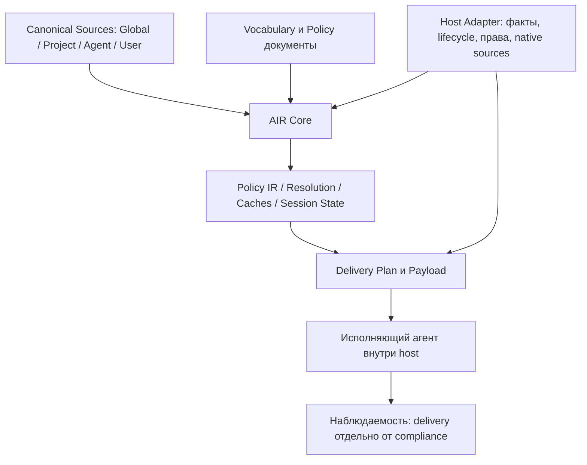
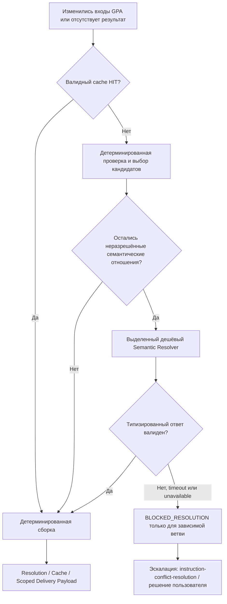

# AIR — Agent Instruction Runtime: рабочая архитектура

**Редакция:** 2026-10-22 / harness-neutral architecture, уточнённый resolver и эскалация конфликтов  
**Статус:** консолидированная база по handoff и последующему диалогу, **не** утверждение технической работоспособности.  
**Назначение:** единый словарь и описание архитектуры для реализации; спорные места явно отмечены `OPEN` или `RUNTIME_GATE`.

## 0. Назначение AIR и архитектурная граница

**AIR (Agent Instruction Runtime)** управляет жизненным циклом инструкций агента: выбирает источники, проверяет их форму и применимость, разрешает противоречия, сохраняет результаты, подготавливает инструкции для модели и восстанавливает их при изменениях контекста. Архитектура независима от конкретного harness. **Первая интеграция**: Codex Desktop на Windows.

**Policy отвечает:** «При каких условиях что обязательно, запрещено, разрешено или предпочтительно?»

**Skill отвечает:** «Каким способом и в какой последовательности достичь результата?»

Отсюда следует разделение языка и исполнения:

- **Policy** описывает нормативные ограничения поведения. В неё входят условия применимости и требования к действию или результату.
- **Skill** описывает процедуру работы: шаги, выбор дальнейших действий, проверку результатов и повторные попытки.
- **AIR** готовит, разрешает и доставляет применимые инструкции через механизмы host. Для навыков используются штатные механизмы обнаружения host; AIR не создаёт параллельный реестр skills.

В будущем **планируется интегрировать в AIR функциональность менеджмента skills**. Текущая работа посвящена policy language, resolution, delivery, восстановлению инструкций и состоянию сессии. Декларативная логика условий (`all/any/not`) входит в policy language; процедурное управление выполнением относится к skills.

## 1. Канонический словарь

Подробные определения, жизненные циклы и примеры находятся в **[`07_GLOSSARY_RU.md`](07_GLOSSARY_RU.md)**. Этот словарь является единым справочником терминов пакета.

| Термин | Значение в AIR |
|---|---|
| **Canonical Source** | Выбранный исходный файл или другой авторитетный носитель инструкций; изменения отслеживаются по fingerprint. |
| **Global Policy (G)** | Общие правила для нескольких проектов и агентных профилей в пределах своего scope. |
| **Project Policy (P)** | Правила конкретного репозитория, проекта или его поддерева. |
| **Agent Profile (A)** | Ролевые инструкции специализированного агента. Конкретный механизм хранения и доставки определяет host. |
| **User Instruction / Current User Prompt** | Прямое указание пользователя / текущее сообщение, предоставленное исполняющему агенту host. |
| **Session Directive** | Пользовательское указание, продолжающее действовать в этой сессии. |
| **Session State** | Сохраняемое состояние директив с версиями, статусами и происхождением. |
| **GPA Resolution** | Результат разрешения применимых Global, Project и Agent правил. |
| **Resolution Overlay / Conflict Decision** | Машинная карта отношений и конкретное решение по одному конфликту. |
| **GPA Cache / Resolution Decision Cache** | Кэши всего GPA Resolution и отдельных разрешённых конфликтов. |
| **Format Schema / Vocabulary / Policy / Rule** | Формат документа / объявление понятий / нормативный документ / отдельное правило. |
| **Policy IR / Graph** | Производное представление структурных правил, источников и отношений. |
| **Host Adapter / Delivery Plan** | Интеграция AIR с механизмами конкретного host / вычисленный план доставки применимых правил. |
| **Native Source / Managed Source** | Источник со штатной доставкой средствами host / источник, доставку которого выполняет AIR. |
| **Delivery Payload / Recovery Payload** | Готовые инструкции для hook / их набор для восстановления состояния. |
| **Policy Trace** | Диагностические записи о попытках и подтверждениях доставки. |

## 2. Источники и authority

Желаемая логическая иерархия **внутри пользовательски управляемого слоя**:

`текущая явная User Instruction > действующие Session Directives > Agent Profile > Project Policy > Global Policy`.

Логическая иерархия AIR применяется внутри пользовательски управляемых источников. **Протокольные уровни полномочий определяются host**, а Host Adapter фиксирует доступные уровни доставки, фактический приоритет сообщений и ограничения делегирования. Логическая резолюция не изменяет протокольный приоритет host. Неудовлетворимая из-за этого конфигурация получает локальный blocker.

`silent` mode: применять подтверждённый приоритет автоматически и фиксировать решение. `interactive` mode: блокировать зависимое действие при существенном неразрешённом конфликте и запрашивать решение.

**Нормативный контракт один.** Semantic Resolver выполняет автоматический анализ правил. Адаптированный [`instruction-conflict-resolution` skill](../skills/instruction-conflict-resolution/SKILL.md) разбирает эскалированные конфликты по тому же контракту. Shared Policy предоставляется skill через интеграцию host. Изменение самого Shared Policy в эту редакцию не входит.

**Правило вызова resolver:** семантические отношения, не выводимые детерминированно, вычисляются отдельным дешёвым resolver при отсутствии валидного кэшированного решения. Root не выполняет массовую семантическую резолюцию. Недоступность/ошибка resolver не подменяется предположением о совместимости правил. Зависимая резолюция получает `BLOCKED_RESOLUTION`; независящая работа продолжается.

**Native ownership:** если host уже доставил Native Source, AIR включает её в вход резолюции и не повторяет body в Delivery Payload. Изменение источника инвалидирует связанные результаты. AIR не может удалить уже доставленную host инструкцию фильтрацией собственного payload. Такой случай должен быть проверен и разрешён через доступные механизмы host либо заблокирован.

### Архитектурные границы



- **AIR Core:** нормативная модель, валидатор, resolver, состояние и детерминированная сборка.
- **Host Adapter:** точка интеграции с транспортом, протокольными правами, lifecycle-событиями, native sources и runtime facts. Возможности host документируются проверенным capability contract.
- **Первая интеграция:** Codex Desktop / Windows, но формат Policy и алгоритмы Core не должны зависеть от имён событий или файлов Codex.

## 3. Authoring/compilation boundary

### 3.1 Format Schema, Vocabulary, Policy, Rule

AIR поставляет форматные определения `air.vocabulary/v1` и `air.policy/v1` (например, JSON Schema и фиксированные семантические проверки). В authored файлах поле `format` **ссылается** на эту схему, но не определяет её:

```yaml
format: air.vocabulary/v1
namespace: example
version: 1
operations:
  probe.execute:
    description: Execute a configured probe to collect reachability evidence.
    parameters:
      strategy:
        type: identifier
        description: Selected probe strategy identifier.
```

```yaml
format: air.policy/v1
uses: [example@1]
rules:
  - key: probe.strategy_required # optional
    modality: require
    operation: example.probe.execute
    parameters:
      strategy:
        exists: true
    description: A probe must identify its strategy.
```

Это **иллюстрация рабочей грамматики**, не утверждённый formal schema file. **Согласование семантики Schema v1 отложено пользователем.** До согласования нельзя считать нормативными семантику `parameters`, `permit`, `applies_if`, missing facts и нормализацию literals. Ошибочно принимать пример за готовый AST-контракт.

**Разделение:** Format Schema определяет допустимую структуру. Vocabulary свободно объявляет symbols/parameters/facts и их human-readable descriptions. Policy ссылается на symbols и задаёт нормативные Rules; Vocabulary не хранит обязанностей/запретов. `Rule` не объявляет Vocabulary inline.

### 3.2 Детерминированность

**Детерминированная область:** YAML/JSON parsing, Format Schema validation, namespace lookup, symbol/type checking, canonicalization, handles/hashes, `applies_if` как булево дерево над фактически доступными typed runtime facts, literal comparison, проверка полномочий по заранее утверждённому контракту, cache, assembly, trace.

**Недетерминированная область:** свободные поля `description` Vocabulary и Rule; семантическое сопоставление правил/описаний; выделение persistently effective user directives из разговорного текста. Дешёвая модель возвращает *ограниченный типизированный результат*, который AIR валидирует. Не может редактировать canonical texts, назначать authority, скрыто менять scope или invent new symbols.

Детерминированность структуры не даёт автоматической гарантии, что модель-исполнитель последует инструкциям. AIR измеряет delivery и compliance раздельно.

**Операции и факты:** синтаксис и регистрация символов детерминированы; содержимое vocabulary свободно расширяется и версионируется. Имя `test.run` существует только если оно зарегистрировано. Поля типов параметров проверяются по declaration словаря, а не угадываются AIR. Возможны extension vocabularies. Unresolved symbol → validation error, без автоматического создания словаря через LLM.

`modality`: рабочий словарь `require`, `forbid`, `permit`, `prefer` (смысл `permit` как исключения требует точной формализации). `applies_if` поддерживает декларативные `all/any/not` и типизированные сравнения с известными facts, но не исполняет алгоритмы. `description` — opaque natural language. Универсальные `subject`, `target`, BDD GIVEN/WHEN/THEN и обязательные ручные IDs отвергнуты; `key` опционален. Стабильный технический handle + отдельный content hash.

### 3.3 Policy Graph и fine-grained cache

Policy Graph — **производная структура памяти**, а не Neo4j или отдельный сервис. Узлы: Sources, Rules; рёбра: contains, equivalent, conflicts, refines, overrides с provenance. Не весь граф обязан быть DAG: циклы возможны у эквивалентности/конфликтов; запрет циклов применим только к будущим действительно зависимостным directed edge types, если они понадобятся. Стабильные идентификаторы Rules и hashes дают потенциальное переиспользование Conflict Decisions. Переносимость решения зависит от неизменности scope и релевантного контекста: нельзя считать пару hash полностью достаточной при появлении третьего правила.

### Схема разрешения неопределённости



Проверка валидности результата LLM не является доказательством семантической истинности решения. Вызов resolver на критическом пути hook разрешается только при подтверждённом budget/latency contract; выбор precompile/fallback проверяется экспериментами.

## 4. Runtime flow

### 4.1 Initial session

```text
Selected Canonical Sources G/P/A
   → parse/validate + runtime facts, предоставленные Host Adapter
   → GPA fingerprint → GPA cache HIT/MISS
   → MISS: deterministic analysis → resolver для оставшихся смысловых отношений
   → validated Resolution Overlay / Conflict Decision cache
   → Delivery Plan (штатная доставка host или AIR-managed, по источнику)
   → Delivery Payload (без повторения native bodies)
   → подтверждённое lifecycle-событие Host Adapter
   → контекст исполняющего агента + Current User Prompt
```

Результат в cache — inspectable resolved view + decisions; агенту-исполнителю доставляются конкретные инструкции, а не hashes/ссылки для дополнительного чтения.

### 4.2 Новый пользовательский turn

- Текущее сообщение предоставляется Root штатным механизмом host. Его протокольная роль устанавливается host.
- В первой интеграции событие `UserPromptSubmit` *может* вызвать отдельный дешёвый extractor обновлений Session Directives и записать Session State без model injection. Это `RUNTIME_GATE`: dispatch, задержка, согласованность записи и recovery должны быть проверены.
- В этой интеграции `UserPromptSubmit` также может доставлять канонические краткие hot reminders из прежнего handoff; новый side-effect design конфликтует с ранее утверждённым обязательным hot path. **Решение по двум назначениям event не принято; тест должен измерить и предъявить конкретный вариант или `BLOCKED`.**
- Root видит новое указание через normal prompt. Прежние Session Directives остаются в истории до compaction; после compaction восстановление берёт актуальный Session State.

### 4.3 Compaction / resume

```text
Host lifecycle: context reduction / resume
   → Host Adapter сообщает event, доступные факты и доставленные native sources
   → перечитать fingerprints и актуальный GPA Resolution
   → прочитать активный Session State
   → собрать Recovery Payload для AIR-managed sources и директив
   → доставить подтверждённым транспортом до следующего model request
```

Recovery требует доказанного транспортного контракта host. Уведомление о compaction и подтверждение model-visible recovery являются разными событиями. Native Source не дублируется, если host её уже сохранил. Если это неизвестно, достоверность восстановления не утверждается. В Codex-адаптере отдельно проверить `PostCompact` и `SessionStart(source=compact)`.

### 4.4 Subagent

```text
Host запускает child с Agent Profile A
   → Host Adapter сообщает профиль, scope и доступное lifecycle-событие
   → scoped GPA Resolution (Agent + Project + Global)
   → применимые Session Directives
   → AIR Payload без повторения native Agent Profile body
   → подтвердить фактическую видимость в контексте child
```

Наследование Root context не подтверждает работу специализированного lifecycle-события. Применимость ролей и поддерева устанавливается из верифицированных runtime facts. Для Codex проверить `SubagentStart`; не угадывать scope исключительно по `cwd`.

### 4.5 Delegation приоритетов

Рабочий, ещё не экспериментально доказанный вариант:
- если host допускает узкую делегацию в Native Agent Profile, профиль разрешает current user overrides только в отношении **своих** требований; миграция профиля требует отдельного подтверждения;
- AIR Payload self-delegates current user overrides внутри **текста этого payload**;
- GPA конкуренция A/P/G уже разрешена до runtime.

Если это нарушается, fallback не состоит в более длинной декларации приоритетов: нужно выбирать другой transport/перенастраивать конфликтующие native sources, либо фиксировать `BLOCKED`.

## 5. Persistence, cache, trace

Разделение config/canonical sources и runtime state зафиксировано. Ниже только **пример layout первой Codex/Windows интеграции**, не стандартный путь AIR Core:

```text
~/.agents/policies.toml                  # selected sources; первоначальный config candidate
%LOCALAPPDATA%/AIR/
  cache/gpa/<fingerprint>/{resolution.json,effective.md}
  cache/conflicts/<fingerprint>.json
  sessions/<session-id>.json             # durable state на протяжении resumable session
  trace/policy-delivery.jsonl            # bounded, no raw bodies
```

Для Core место хранения конфигурируется через Host Adapter. `%LOCALAPPDATA%` и `PLUGIN_DATA` являются кандидатами **для Windows/Codex integration**, а не частью универсального AIR Core contract. Atomic writes, simultaneous hook concurrency, dedup generation, file locks и recovery после partial write обязательны. Cache entries имеют origin hashes, vocabulary/schema/authority/resolver versions, scope и provenance; при ручных корректировках generated `effective.md` нельзя молча принять за canonical source: correction нужна в отдельном explicit override, привязанном к hash (формат открыт).

## 6. Host integration и первый адаптер

**Универсальный контракт:** Host Adapter определяет способы загрузки Shared Policy, native источники, протокольные уровни полномочий, lifecycle events, runtime facts, ограничения размера/задержки payload и доступные подтверждения доставки. Adapter может объявить capability unsupported, что приводит к локальному blocker, а не к имитации транспорта.

**Codex Desktop / Windows reference:** проверить native `AGENTS.md`, custom agent `developer_instructions`, hooks `SessionStart`, `UserPromptSubmit`, `SubagentStart`, `PostCompact`, `additionalContext` и их реальные роли. Исторический bootstrap `~/.agents/AGENTS.md → ENTRYPOINT.md → ~/.agents/shared/` проверяется только как частный экземпляр первой интеграции, не часть AIR Core.

Agent Plugins использует root `plugin.json` (`$schema: https://agent-plugins.org/schemas/1.0.0/plugin.schema.json`) и `extensions.com.openai` для специфичных hooks, а также compatibility `.codex-plugin/plugin.json` в соответствующих конфигурациях. Это упаковка первой интеграции, не runtime ABI Policy. Поддержка проверяется на установленном Desktop; MCP сервер без отдельного основания не вводить.

## 7. Инварианты

1. Нет незаявленного read/glob произвольных repo docs и повышения project content в developer authority.
2. Один source может участвовать в resolution, но его body доставляет только один выбранный mechanism.
3. Cache hit ≠ доказательство наличия инструкции в model context; generation и compaction требуют отдельной логики.
4. Успешный hook return ≠ доказательство model-visible full delivery/поведения.
5. Структурная зона не содержит свободной неограниченной natural-language semantics; `description` является явной opaque зоной.
6. LLM никогда не пишет/меняет canonical source автоматически и не формирует новые vocabulary symbols.
7. У agent-исполнителя нет обязанности читать overlay/trace/исходники ради текущего исполнения; ему доставляется итоговый применимый текст.
8. Session State отделён от GPA cache и сохраняется при resumable session.
9. Отсутствие гарантированного host transport → доказательный blocker соответствующего acceptance, не `DONE`.
10. Изменения в действующей пользовательской `.agents` требуют permission preflight, резервной копии, проверяемого diff и rollback.

## 8. Открытые вопросы и владельцы решений

- **RUNTIME_GATE:** Codex Desktop: hooks, message roles/precedence, full context/recovery, native sources и subagents. См. [`05_EXPERIMENTAL_TZ_RU.md`](05_EXPERIMENTAL_TZ_RU.md). Владелец: агент-исследователь, затем user approval при несовместимости.
- **SCHEMA_GATE:** точная grammar/types/`permit`/условия `unknown fact`, поддержка частично natural-language только в description, stable handles. Владелец: пользователь + архитектурный review по отчёту прототипа, без скрытых расширений.
- **TRANSPORT_GATE:** conflicting native higher authority и очистка global bootstrap. Владелец: пользователь после evidence.
- **UX_GATE:** формат ручных patches/corrections и их migration при изменении source hash. Владелец: пользователь после практического mockup.
- **ПЛАНИРУЕМОЕ РАСШИРЕНИЕ:** функциональность менеджмента skills в AIR. Состав функций и формат интеграции согласуются отдельно.
